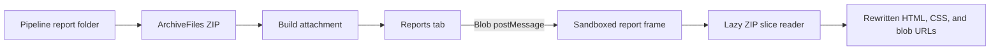

# Contributing

## Prerequisites

- Node.js 26 (see `.nvmrc`)
- The `zip` command, used to generate test fixtures
- Optionally `7z` and `pwsh`, which add archive-compatibility test cases; those cases are skipped when the tools are missing

```sh
npm ci
npx playwright install --with-deps
```

## Development

| Command | Purpose |
| --- | --- |
| `npm run dev` | Vite dev server. Outside Azure DevOps the tab shows a file picker for any local report ZIP, or the fixture reports once they are generated. |
| `npm run fixtures` | Generate fixture report archives from the real reporters (see below). |
| `npm run harness` | Production build served with the fixture harness, on `http://127.0.0.1:4173/tab.html`. |
| `npm run lint` | oxlint |
| `npm run build` | Type check, bundle, and enforce bundle size budgets. |
| `npm test` | Unit tests (Vitest). |
| `npm run test:e2e` | Generate fixtures, then run the browser tests against the harness in Chromium, Firefox, and WebKit. |

The harness simulates run states with `?scenario=`: `in-progress`, `empty`, and `matrix`.

### How It Works



The host tab owns the Azure DevOps access token and only sends the chosen report Blob to the opaque-origin frame. The report frame resolves report-local resources from that Blob; it never receives a token and cannot request host-side fetches or downloads. Each report page runs in an opaque-origin sandbox at the extension's `report-document.html` URL, under a Content-Security-Policy that only allows `blob:` and `data:` resources.

### Compatibility Fixtures

`npm run fixtures` builds each fixture from the tool versions pinned in `package.json`. The suite in `test/fixtures/sources/playwright-suite` includes an intentional failure so reporters capture screenshots, videos, and traces.

| Fixture | Generator | Covered |
| --- | --- | --- |
| Hand-written static site | hand-written | CSS-relative font and background, `srcset`, `fetch` JSON, second page, `../` link, back/forward, download |
| reporting-labs default | reporting-labs | Hash routes, screenshot, video from `assets/`, 3 MB attachment over `embedLimit`, trace download, theme storage |
| reporting-labs `embedVideos: true` | reporting-labs | Embedded `data:` video |
| Playwright HTML | @playwright/test | Hash-routed details, screenshot, video, attachment download |
| Istanbul lcov-report | nyc | Directory and file drill-down, back/forward, ordered classic scripts |
| Allure static | allure (Node, no Java) | Webpack chunks, hash routes to test details |
| Security probe | hand-written | Parent/top access blocked, spoofed and malformed messages ignored, no host fetches, external fetch/image/script blocked |

## Commits and Versioning

Commits follow [Conventional Commits](https://www.conventionalcommits.org/). GitVersion (`GitVersion.yml`) derives the version from them on `main`:

- `feat:` bumps the minor version, `fix:`, `perf:`, and `refactor:` bump the patch version, and `!` or `BREAKING CHANGE:` bumps the major version.
- `build:`, `chore:`, `ci:`, `docs:`, `style:`, `test:`, and `revert:` do not bump the version, so they are not released on their own.

## Packaging and Publishing

The publisher identity is never committed: `vss-extension.json` has no `publisher`, and `scripts/extension.ts` supplies it to `tfx` from the environment. Locally, copy `.env.example` to `.env` (gitignored) and set:

| Variable | Needed for | Description |
| --- | --- | --- |
| `EXTENSION_PUBLISHER` | `npm run package`, `npm run publish` | Marketplace publisher ID |
| `EXTENSION_SHARE_WITH` | `npm run publish` | Azure DevOps organization(s) to share with, separated by spaces or commas |
| `AZURE_DEVOPS_EXT_PAT` | `npm run publish` | PAT with the Marketplace (publish) scope |
| `EXTENSION_VERSION` | optional | Overrides the `package.json` version (set by the release workflow) |

`npm run package` writes the VSIX to `release/`; `npm run verify:vsix` checks that it contains no sources or source maps. `npm run publish` packages, then publishes and shares the extension.

## Continuous Delivery

GitHub Actions builds, tests, and releases the extension:

- `ci.yml` runs on pushes to branches other than `main`: lint, build, unit and browser tests, and packaging.
- `release.yml` runs on pushes to `main`. It runs the same checks and, when the version changed, creates a `v<version>` GitHub release with the VSIX attached. Commits that don't bump the version and Dependabot updates are built and tested but not released on their own.
- `publish.yml` is started manually with a release tag. It publishes that release's VSIX to the Marketplace and shares it with the configured organizations.
- `codeql.yml` scans the TypeScript sources and the workflows on pushes and pull requests to `main`, and weekly.
- Dependabot opens grouped weekly updates for npm packages and GitHub Actions.

Configure the repository (the publish job runs in the `marketplace` environment, so its variable and secret can be set there):

| Name | Kind | Used by |
| --- | --- | --- |
| `EXTENSION_PUBLISHER` | Variable | `ci.yml` (optional), `release.yml`, `publish.yml` |
| `EXTENSION_SHARE_WITH` | Variable | `publish.yml` |
| `AZURE_DEVOPS_EXT_PAT` | Secret | `publish.yml` |
